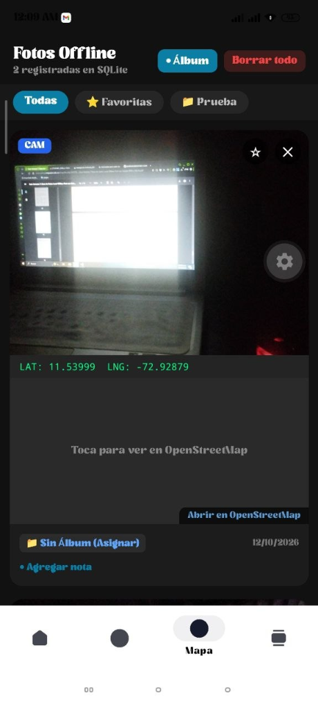
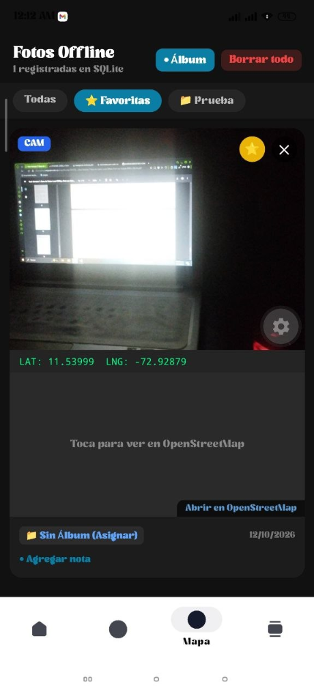
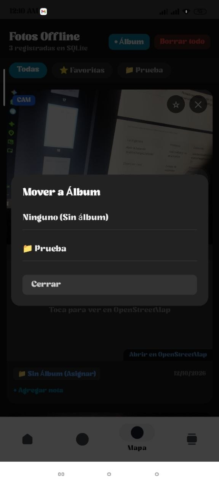
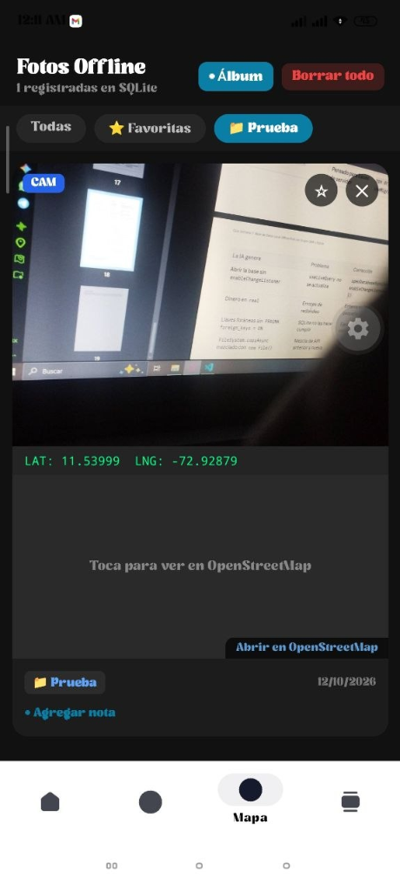
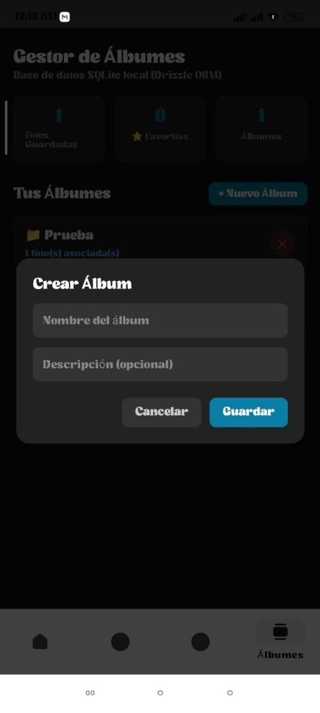
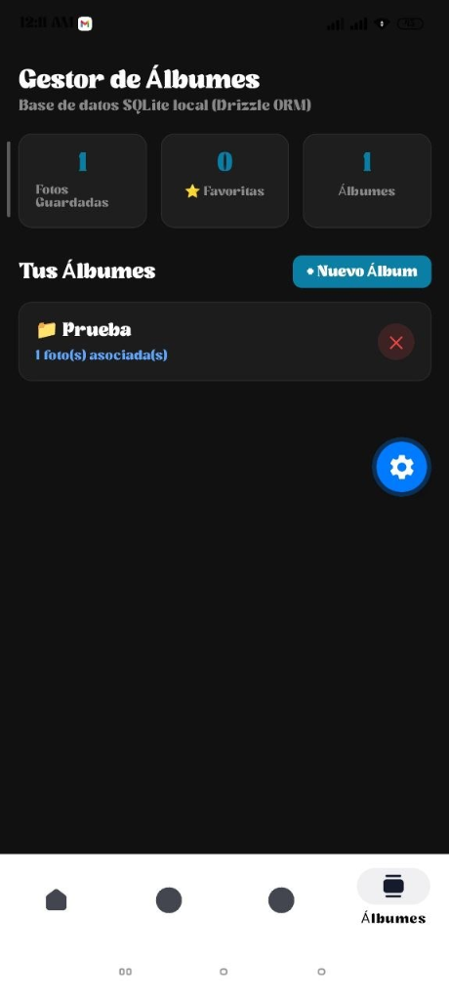
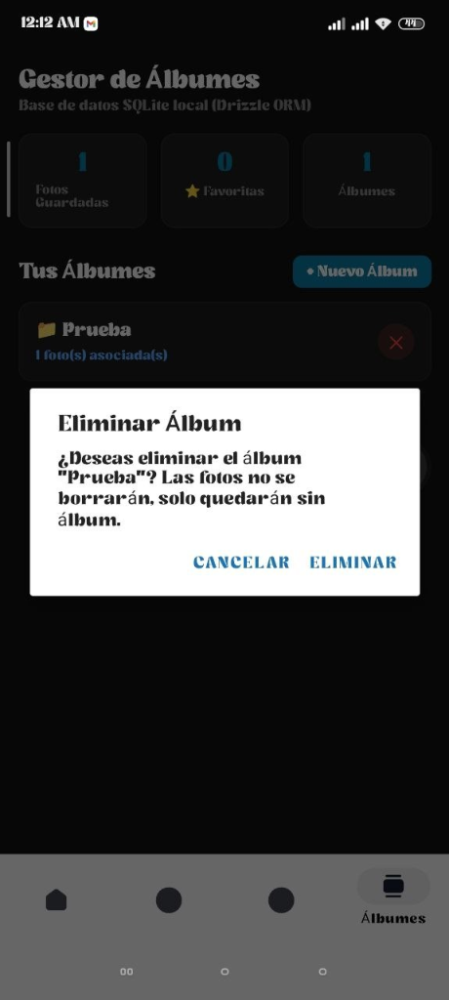
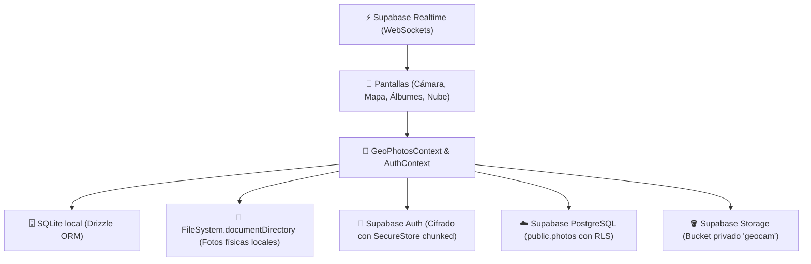

# 📸 GeoCam

Aplicación móvil desarrollada con **React Native + Expo SDK 57** que permite tomar fotografías geolocalizadas, importar imágenes desde la galería y visualizarlas en una galería con coordenadas GPS.

---

## 🎯 Características principales

- **Cámara con geolocalización** — Toma fotos que se etiquetan automáticamente con tus coordenadas GPS en tiempo real.
- **Importar desde galería** — Selecciona imágenes existentes y se les asigna tu ubicación actual.
- **Galería de fotos** — Visualiza todas las fotos capturadas con sus coordenadas, fuente (CAM/GAL) y opción de eliminar.
- **Permisos en contexto** — La app solicita permisos de cámara y ubicación de forma progresiva, nunca al abrirse.
- **Degradación elegante** — Si se niega el GPS, la cámara sigue funcionando y la app lo comunica al usuario.
- **Detección de shake** — Al agitar el teléfono, se ofrece borrar todas las fotos registradas.
- **Botón "Abrir Ajustes"** — Si un permiso es bloqueado definitivamente, se muestra un botón para ir a los ajustes del sistema.

---

## 📱 Capturas de pantalla y Evidencias de Funcionamiento

### 🗄️ Semana 7: Base de Datos Local Offline-First (SQLite + Drizzle ORM)

#### 🔹 Galería Persistente, Favoritas y Relaciones
<table>
  <tr>
    <td align="center" width="25%">
      <br/>
      <b>📸 Galería Offline en SQLite</b><br/>
      <sub>Persistencia en SQLite (<code>geocam.db</code>) y fotos en <code>FileSystem.documentDirectory</code>. Contador en vivo y barra GPS.</sub>
    </td>
    <td align="center" width="25%">
      <br/>
      <b>⭐ Favoritas (Migración 2)</b><br/>
      <sub>Columna <code>is_favorite</code> agregada por migración SQL. Alternado reactivo con estrella activa y filtrado instantáneo vía <code>useLiveQuery</code>.</sub>
    </td>
    <td align="center" width="25%">
      <br/>
      <b>📁 Asignación a Álbum</b><br/>
      <sub>Modal para relacionar fotos con la tabla <code>albums</code> mediante clave foránea (<code>album_id</code>).</sub>
    </td>
    <td align="center" width="25%">
      <br/>
      <b>🔍 Filtrado por Álbum</b><br/>
      <sub>Pestaña del álbum <b>"Prueba"</b> activa, mostrando únicamente las fotos vinculadas a ese álbum y su badge correspondiente.</sub>
    </td>
  </tr>
</table>

#### 🔹 Gestión de Álbumes, Métricas e Integridad Referencial
<table>
  <tr>
    <td align="center" width="33%">
      <br/>
      <b>➕ Creación de Álbum</b><br/>
      <sub>Modal para ingresar nombre y descripción, insertando un nuevo registro en la tabla <code>albums</code>.</sub>
    </td>
    <td align="center" width="33%">
      <br/>
      <b>📊 Gestor y Métricas SQLite</b><br/>
      <sub>Pestaña <b>Álbumes</b> con métricas en tiempo real (Fotos, Favoritas, Álbumes) y conteo reactivo de fotos asociadas.</sub>
    </td>
    <td align="center" width="33%">
      <br/>
      <b>🗑️ Integridad (ON DELETE set null)</b><br/>
      <sub>Al eliminar el álbum, las fotos no se borran; quedan sin álbum preservando su integridad y archivo físico.</sub>
    </td>
  </tr>
</table>

### 🔐 Semana 6: Cámara, Permisos en Contexto y Degradación Elegante

<table>
  <tr>
    <td align="center" width="33%">
      <br/>
      <b>❌ Rechazado (Denied)</b><br/>
      <sub>La app pide el permiso en contexto con un botón "Conceder permiso".</sub>
    </td>
    <td align="center" width="33%">
      <br/>
      <b>🔒 Bloqueado (Blocked)</b><br/>
      <sub>Si el usuario denegó permanentemente, aparece el botón "Abrir Ajustes".</sub>
    </td>
    <td align="center" width="33%">
      <br/>
      <b>Cámara sin GPS</b><br/>
      <sub>Degradación elegante: la cámara sigue funcionando sin bloquear al usuario.</sub>
    </td>
  </tr>
</table>

---


## 🛠️ Tecnologías utilizadas

| Tecnología | Uso |
|---|---|
| **React Native 0.86** | Framework de desarrollo móvil |
| **Expo SDK 57** | Plataforma de desarrollo y build |
| **Expo Router** | Navegación basada en archivos |
| **expo-sqlite** | Base de datos local SQLite con `openDatabaseSync` |
| **drizzle-orm & drizzle-kit** | ORM type-safe con migraciones SQL y consultas reactivas (`useLiveQuery`) |
| **expo-file-system** | Persistencia física de fotos en `documentDirectory` |
| **expo-camera** | Acceso a la cámara del dispositivo |
| **expo-location** | Geolocalización (GPS) |
| **expo-image-picker** | Selección de imágenes de galería |
| **expo-sensors** | Acelerómetro (detección de shake) |
| **TypeScript** | Tipado estricto sin `any` |

---

## 🏗️ Arquitectura Offline-First de 5 Capas

```
┌────────────────────────────────────────────────────────┐
│ 1. Pantalla (UI): geocam.tsx, mapa.tsx, explore.tsx    │
├────────────────────────────────────────────────────────┤
│ 2. Hooks Reactivos: useGeoPhotosDB, useAlbumsDB        │
├────────────────────────────────────────────────────────┤
│ 3. Repositorios: photoRepository, albumRepository      │
├────────────────────────────────────────────────────────┤
│ 4. Drizzle ORM / Esquema: schema.ts, relaciones        │
├────────────────────────────────────────────────────────┤
│ 5. Motor SQLite: expo-sqlite (openDatabaseSync)        │
└────────────────────────────────────────────────────────┘
```

---

## 📁 Estructura del proyecto

```
src/
├── app/
│   ├── _layout.tsx          # Layout raíz con migrador runtime (useMigrations)
│   ├── index.tsx            # Redirect automático a /geocam
│   ├── geocam.tsx           # Pantalla de cámara principal
│   ├── mapa.tsx             # Galería interactiva (notas, favoritas, mapa)
│   └── explore.tsx          # Gestor de Álbumes y métricas SQLite
├── components/
│   ├── PermissionPrimer.tsx # UI para solicitar permisos
│   ├── app-tabs.tsx         # Navegación por pestañas (nativo)
│   └── app-tabs.web.tsx     # Navegación por pestañas (web)
├── context/
│   └── GeoPhotosContext.tsx # Puente reactivo entre repositorios y pantallas
├── db/
│   ├── client.ts            # Conexión SQLite con PRAGMA foreign_keys = ON;
│   └── schema.ts            # Esquema Drizzle (tablas albums y photos)
├── drizzle/
│   ├── 0000_init_albums_and_photos.sql # Migración 1: Tablas base
│   ├── 0001_add_notes_and_favorites.sql# Migración 2: Notas y Favoritas
│   └── migrations.js        # Índice para el migrador móvil
├── hooks/
│   ├── useAlbumsDB.ts       # Hook reactivo de álbumes (useLiveQuery)
│   ├── useCamera.ts         # Hook: permisos, captura, flip cámara
│   ├── useGeoLocation.ts    # Hook: GPS en tiempo real + cleanup
│   ├── useGeoPhotosDB.ts    # Hook reactivo de fotos (useLiveQuery)
│   └── useShake.ts          # Hook: detección de shake + cleanup
├── repositories/
│   ├── albumRepository.ts   # CRUD encapsulado de álbumes
│   └── photoRepository.ts   # CRUD encapsulado de fotos y borrado físico
├── services/
│   └── photoStorage.ts      # Manejo permanente de imágenes (FileSystem)
└── types/
    ├── declarations.d.ts    # Tipos para archivos .sql y migraciones
    └── geo.ts               # Tipos: Coords, GeoPhoto, PermissionState
```

---

## 🧪 Hooks implementados

### `useCamera` (`hooks/useCamera.ts`)
Encapsula permisos de cámara, referencia a `CameraView` con `useRef`, captura de foto y toggle frontal/trasera con `prevState`.

### `useGeoLocation` (`hooks/useGeoLocation.ts`)
Maneja permisos de ubicación, watcher GPS en tiempo real con `watchPositionAsync`, y función de cleanup que remueve la suscripción al desmontar.

### `useShake` (`hooks/useShake.ts`)
Detecta el gesto de agitar usando el acelerómetro (`expo-sensors`). Usa `useRef` para el cooldown (sin re-renders) y `callbackRef` para evitar stale closures.

---

## ✅ Reglas de Hooks aplicadas

| Regla | Implementación |
|---|---|
| **Top-Level** | Todos los hooks se llaman al inicio de cada componente/hook |
| **Inmutabilidad** | `setPhotos((prev) => [photo, ...prev])` — spread operator |
| **prevState / Batching** | `setFacing((prev) => prev === 'back' ? 'front' : 'back')` |
| **Cleanup en useEffect** | `return () => { watcherRef.current?.remove(); }` |
| **useRef silencioso** | `intervalRef`, `callbackRef`, `lastShakeRef` sin re-renders |
| **Context API** | `GeoPhotosProvider` evita Prop Drilling entre pantallas |

---

---

## ☁️ Semana 8: Backend as a Service con Supabase

En la Semana 8 se expandió **GeoCam** conectándola con **Supabase** como plataforma de Backend as a Service (BaaS), implementando autenticación con correo/contraseña, almacenamiento cifrado por fragmentos en el dispositivo, base de datos remota PostgreSQL protegida por usuario mediante *Row Level Security (RLS)*, subida de fotos físicas a un bucket privado en *Supabase Storage* y suscripción en tiempo real con *Realtime*.

> **Principio de Diseño Offline-First:** SQLite con Drizzle ORM permanece como la **fuente de verdad local** en el dispositivo móvil, permitiendo un funcionamiento 100% autónomo sin conexión a internet. Supabase actúa como respaldo en la nube y punto de encuentro multi-dispositivo.



### 📋 Características implementadas (Taller T1-T6 + Casa C1-C7)

1. **Almacenamiento seguro por fragmentos (`lib/secureStorage.ts`):** Adaptador sobre `expo-secure-store` dividiendo tokens en bloques de 1000 bytes para superar la limitación nativa de 2048 bytes.
2. **Cliente Supabase seguro (`lib/supabase.ts`):** Configurado con `autoRefreshToken: true`, `detectSessionInUrl: false` y listener del ciclo de vida de la app (`AppState`) para suspender el refresco de tokens en segundo plano.
3. **Autenticación completa (`context/AuthContext.tsx`, `app/login.tsx`):** Registro e inicio de sesión con email/password, sesión persistente y cierre de sesión.
4. **Navegación protegida declarativa (`app/_layout.tsx`):** Si no hay sesión activa, la app muestra la pantalla de login directamente, sin redirecciones forzadas ni parpadeos.
5. **Migración incremental Drizzle (`0002_add_sync_fields.sql`):** Adición de `client_id` (UUID), `updated_at`, `remote_path`, `synced_at` y `owner_id` manteniendo intactas las migraciones previas.
6. **Subida binaria con `ArrayBuffer` (`services/cloudPhotos.ts`):** Prevención de archivos de 0 bytes garantizando subidas consistentes en React Native.
7. **Ruta estricta en Storage privado:** Fotos almacenadas bajo `${userId}/${clientId}.jpg` en el bucket privado `'geocam'`.
8. **Visualización con URLs firmadas:** Generación de URLs temporales con expiración (`createSignedUrl`) para visualizar imágenes de buckets privados de forma segura.
9. **Indicadores de estado de sincronización (`app/mapa.tsx`):**
   - ☁️✓ **Nube:** Foto sincronizada sin cambios pendientes.
   - ☁️⬆️ **Pendiente:** Foto modificada localmente pendiente de actualizar en la nube.
   - 📱 **Local:** Foto almacenada solo en el dispositivo.
10. **Sincronización masiva con progreso (`app/mapa.tsx`):** Botón `☁️ Sync Todo` con indicador en tiempo real ("Sincronizando X de Y...").
11. **Pestaña Nube con Realtime (`app/nube.tsx`):** Visualización de fotos respaldadas en Supabase con suscripción activa por WebSockets y limpieza garantizada del canal (`supabase.removeChannel`).
12. **Aislamiento multi-usuario:** Filtrado por `owner_id` para garantizar que en un mismo dispositivo cada usuario solo vea sus fotos locales.
13. **Eliminación sincronizada:** Al eliminar una foto, se limpian el archivo local, el registro SQLite y el objeto en Supabase Storage/PostgreSQL.

---

### ⚙️ Configuración en el Panel de Supabase (SQL Requerido)

Para desplegar la infraestructura en la nube, ejecuta el siguiente script en el **SQL Editor de Supabase**:

```sql
-- 1. Tabla remota de fotos
create table public.photos (
  id bigint generated always as identity primary key,
  user_id uuid not null default auth.uid() references auth.users (id) on delete cascade,
  client_id uuid not null unique,
  storage_path text not null unique,
  latitude double precision,
  longitude double precision,
  note text,
  favorite boolean not null default false,
  source text not null check (source in ('camera', 'gallery')),
  taken_at timestamptz not null,
  updated_at timestamptz not null,
  created_at timestamptz not null default now()
);

-- 2. Activar Row Level Security (RLS)
alter table public.photos enable row level security;

-- Políticas de la tabla photos (aislamiento estricto por usuario)
create policy "ver las mías" on public.photos
  for select to authenticated using ((select auth.uid()) = user_id);

create policy "crear las mías" on public.photos
  for insert to authenticated with check ((select auth.uid()) = user_id);

create policy "actualizar las mías" on public.photos
  for update to authenticated
  using ((select auth.uid()) = user_id)
  with check ((select auth.uid()) = user_id);

create policy "borrar las mías" on public.photos
  for delete to authenticated using ((select auth.uid()) = user_id);

-- 3. Habilitar Realtime en la tabla photos
alter publication supabase_realtime add table public.photos;

-- 4. Crear bucket privado 'geocam' y sus políticas RLS
insert into storage.buckets (id, name, public) values ('geocam', 'geocam', false);

create policy "subir a mi carpeta" on storage.objects
  for insert to authenticated
  with check (bucket_id = 'geocam' and (storage.foldername(name))[1] = (select auth.uid()::text));

create policy "leer mi carpeta" on storage.objects
  for select to authenticated
  using (bucket_id = 'geocam' and (storage.foldername(name))[1] = (select auth.uid()::text));

create policy "actualizar mi carpeta" on storage.objects
  for update to authenticated
  using (bucket_id = 'geocam' and (storage.foldername(name))[1] = (select auth.uid()::text));

create policy "borrar de mi carpeta" on storage.objects
  for delete to authenticated
  using (bucket_id = 'geocam' and (storage.foldername(name))[1] = (select auth.uid()::text));
```

### 🔐 Variables de Entorno

Crea un archivo `.env` en la raíz del proyecto (ignorado automáticamente por `.gitignore`):

```env
EXPO_PUBLIC_SUPABASE_URL=https://TU_PROYECTO.supabase.co
EXPO_PUBLIC_SUPABASE_PUBLISHABLE_KEY=tu_anon_publishable_key
```

> ⚠️ **Seguridad:** Nunca utilices `SUPABASE_SERVICE_ROLE_KEY` en el cliente móvil. Únicamente se debe emplear la clave pública `anon`.

---

## 🚀 Instalación y ejecución

```bash
# Clonar el repositorio
git clone <URL_DEL_REPOSITORIO>

# Entrar a la carpeta del proyecto
cd GEOCAM

# Instalar dependencias
npm install

# Iniciar el servidor de desarrollo
npx expo start
```

> **Nota:** Esta app requiere un dispositivo físico para funcionalidades de cámara, GPS y acelerómetro. Escanea el código QR con **Expo Go** en tu teléfono.

---

## 👤 Autor

**Estudiante(s):** Leonardo Carrillo Caballero