# 📸 GeoCam

Aplicación móvil desarrollada con **React Native + Expo SDK 58** que permite tomar fotografías geolocalizadas, importar imágenes desde la galería y visualizarlas en una galería con coordenadas GPS.

---

## 🎯 Características principales

- **Cámara con geolocalización** — Toma fotos que se etiquetan automáticamente con tus coordenadas GPS en tiempo real.
- **Importar desde galería** — Selecciona imágenes existentes y se les asigna tu ubicación actual.
- **Galería de fotos** — Visualiza todas las fotos capturadas con sus coordenadas, fuente (CAM/GAL) y opción de eliminar.
- **Permisos en contexto** — La app solicita permisos de cámara y ubicación de forma progresiva, nunca al abrirse.
- **Degradación elegante** — Si se niega el GPS, la cámara sigue funcionando y la app lo comunica al usuario.
- **Detección de shake** — Al agitar el teléfono, se ofrece borrar todas las fotos registradas.
- **Botón "Abrir Ajustes"** — Si un permiso es bloqueado definitivamente, se muestra un botón para ir a los ajustes del sistema.

---

## 📱 Capturas de pantalla y Evidencias de Funcionamiento

### 🔄 Semana 9: Motor Offline-First Bidireccional y Evidencias C6

<table>
  <tr>
    <td align="center" width="33%">
      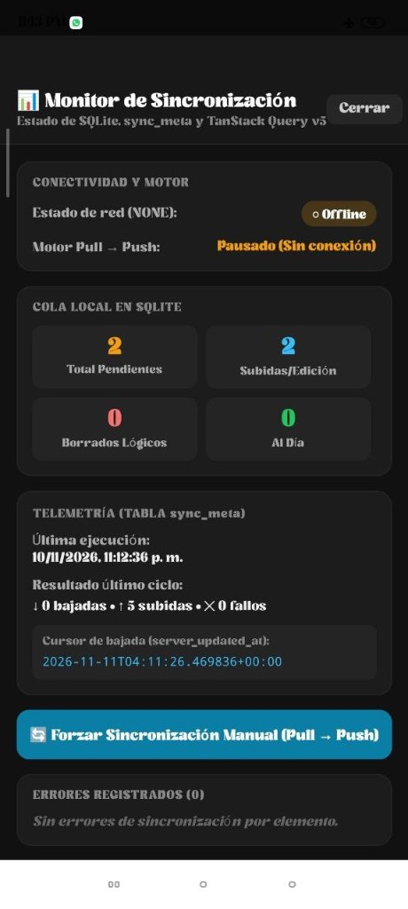<br/>
      <b>1️⃣ C6 #1 — Captura Offline (Pendientes en SQLite)</b><br/>
      <sub>Con modo avión (<code>NONE • Offline</code>) el motor queda pausado y retiene <b>2 pendientes</b> en la cola local de SQLite.</sub>
    </td>
    <td align="center" width="33%">
      <br/>
      <b>2️⃣ C6 #1 — Reconexión Automática (Pendientes → 0)</b><br/>
      <sub>Al volver a WiFi (<code>Online</code>) sube automáticamente <code>↑ 2 subidas • × 0 fallos</code>, dejando <b>0 pendientes</b> y <b>2 Al Día</b>.</sub>
    </td>
    <td align="center" width="33%">
      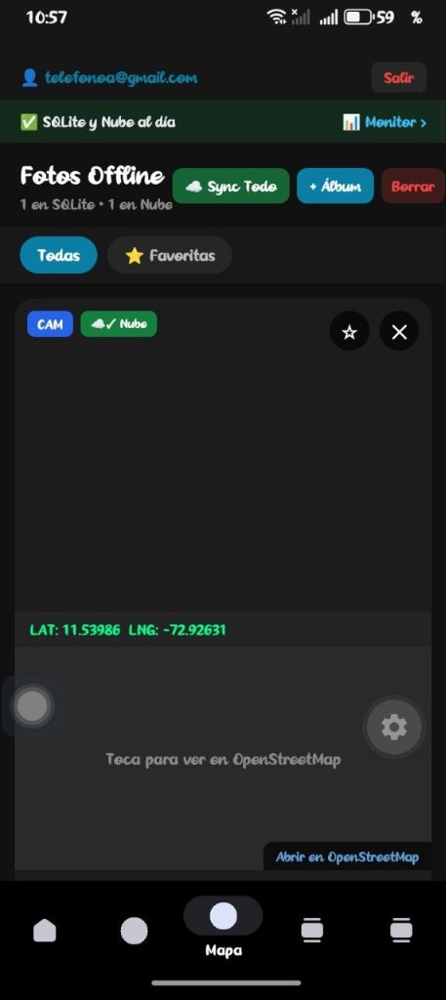<br/>
      <b>3️⃣ C6 #2 — Foto Sincronizada con Imagen y GPS</b><br/>
      <sub>Cuenta <code>telefonoa@gmail.com</code> en estado <code>SQLite y Nube al día</code> (<code>1 en SQLite • 1 en Nube</code>, badge <code>☁️✓ Nube</code> y ubicación <code>11.53986, -72.92631</code>).</sub>
    </td>
  </tr>
  <tr>
    <td align="center" width="33%">
      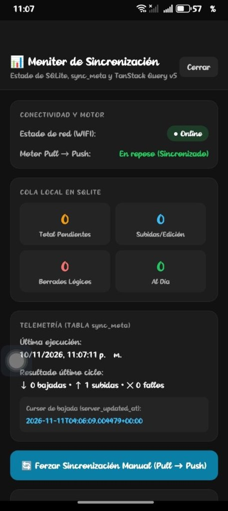<br/>
      <b>4️⃣ C6 #4 — Borrado Lógico Sincronizado</b><br/>
      <sub>Tras borrar la foto, el ciclo sincroniza el tombstone (<code>↑ 1 subidas • × 0 fallos</code>) y deja <b>0 pendientes</b>, <b>0 borrados en cola</b> y <b>0 Al Día</b>.</sub>
    </td>
    <td align="center" width="33%">
      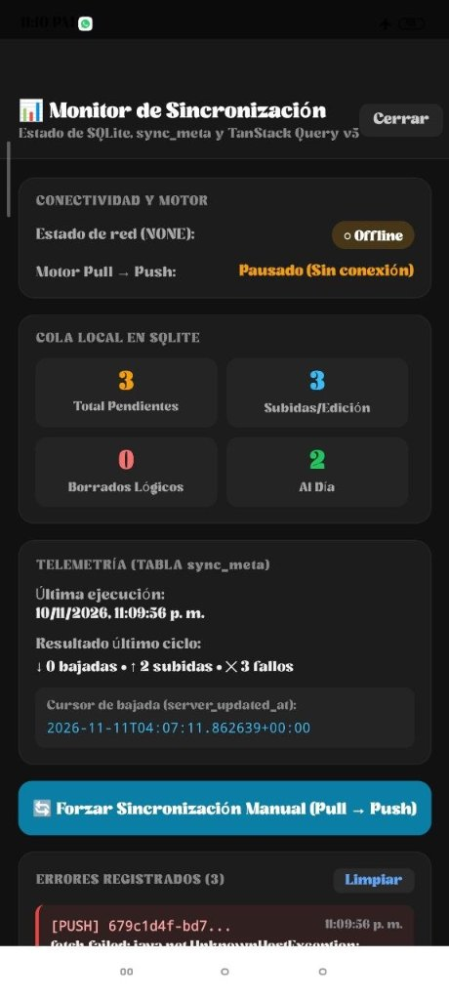<br/>
      <b>5️⃣ C6 #6 — Corte de Red en Lote de 5 Fotos</b><br/>
      <sub>Corte en vivo deja <code>↑ 2 subidas</code> (<code>Al Día: 2</code>) y <code>× 3 fallos</code> (<code>UnknownHostException</code>); los 3 pendientes permanecen seguros en SQLite.</sub>
    </td>
    <td align="center" width="33%">
      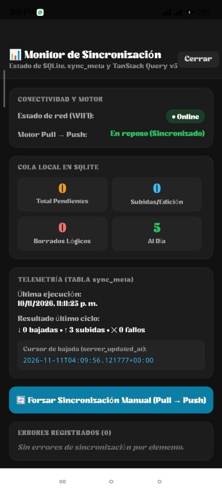<br/>
      <b>6️⃣ C6 #6 — Reconexión Sin Duplicados</b><br/>
      <sub>Al reconectar sube solo las <code>↑ 3 subidas</code> faltantes (<code>× 0 fallos</code>), completando exactamente <b>5 Al Día</b> y <b>0 pendientes</b>.</sub>
    </td>
  </tr>
</table>

### ☁️ Semana 8: Backend as a Service con Supabase (Auth, RLS, Storage y Sync)

#### 🔹 1. Autenticación, Validaciones y Manejo de Errores
<table>
  <tr>
    <td align="center" width="25%">
      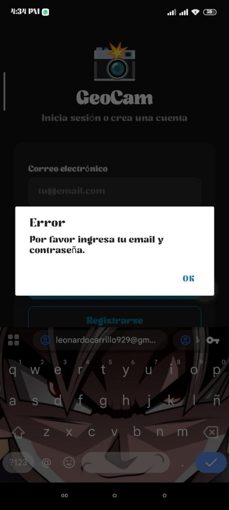<br/>
      <b>⚠️ Validación de Campos</b><br/>
      <sub>Alerta que solicita ingresar email y contraseña si los campos requeridos se dejan vacíos.</sub>
    </td>
    <td align="center" width="25%">
      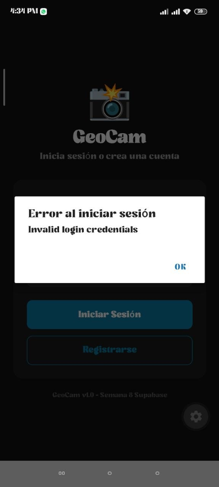<br/>
      <b>🚫 Manejo de Errores Supabase</b><br/>
      <sub>Captura y presentación amigable de errores devueltos por la API de Supabase Auth (credenciales inválidas).</sub>
    </td>
    <td align="center" width="25%">
      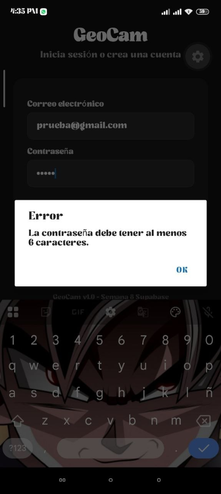<br/>
      <b>🔒 Validación de Seguridad</b><br/>
      <sub>Control preventivo de longitud mínima de 6 caracteres para contraseñas previo a la llamada a Supabase.</sub>
    </td>
    <td align="center" width="25%">
      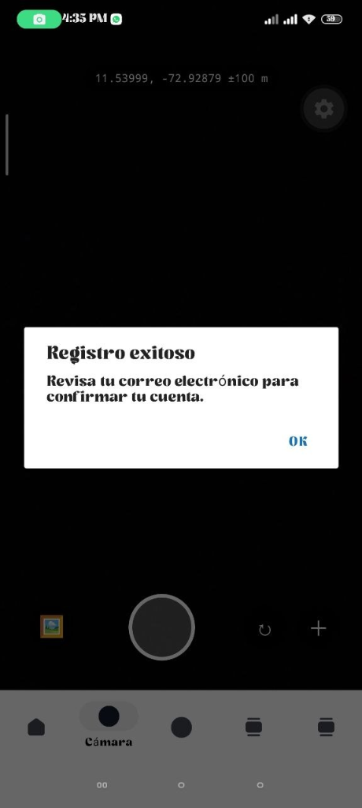<br/>
      <b>✅ Registro y Confirmación</b><br/>
      <sub>Flujo de registro completado exitosamente con mensaje informativo para confirmación de correo.</sub>
    </td>
  </tr>
</table>

#### 🔹 2. Sincronización Local ↔ Nube y Subida Binaria a Storage
<table>
  <tr>
    <td align="center" width="33%">
      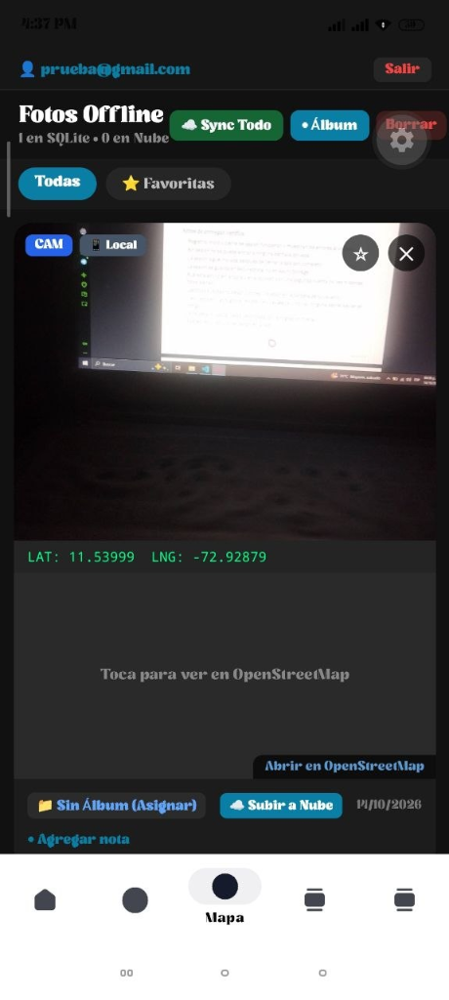<br/>
      <b>📱 Estado Local (Pendiente)</b><br/>
      <sub>Foto capturada en SQLite con badge <code>📱 Local</code>, métricas (<code>1 en SQLite • 0 en Nube</code>) y botón individual para subir.</sub>
    </td>
    <td align="center" width="33%">
      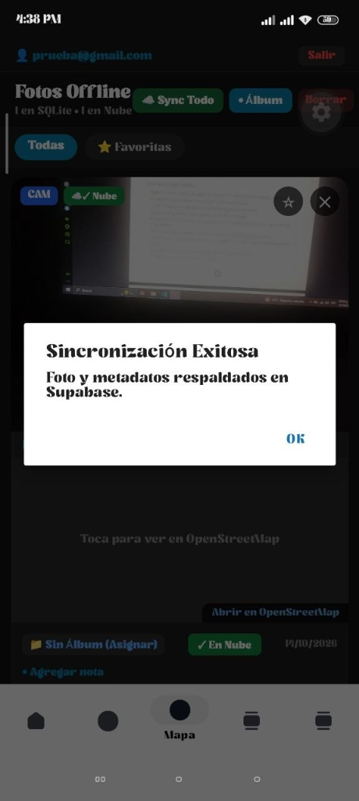<br/>
      <b>☁️ Sincronización Exitosa</b><br/>
      <sub>Subida binaria con <code>ArrayBuffer</code> (evita 0 bytes). Badge actualizado a <code>☁️✓ Nube</code> y contador (<code>1 en SQLite • 1 en Nube</code>).</sub>
    </td>
    <td align="center" width="33%">
      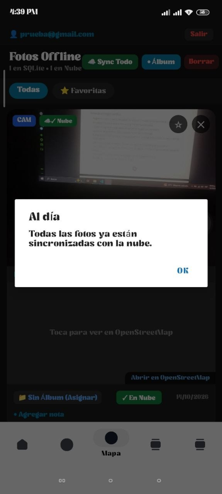<br/>
      <b>🔄 Sincronización Masiva (Al día)</b><br/>
      <sub>Botón <code>☁️ Sync Todo</code>: verifica y notifica que todas las fotos locales ya están respaldadas en Supabase sin duplicar datos.</sub>
    </td>
  </tr>
</table>

#### 🔹 3. Pestaña Nube (Realtime + Storage Privado) y Cierre de Sesión Seguro
<table>
  <tr>
    <td align="center" width="33%">
      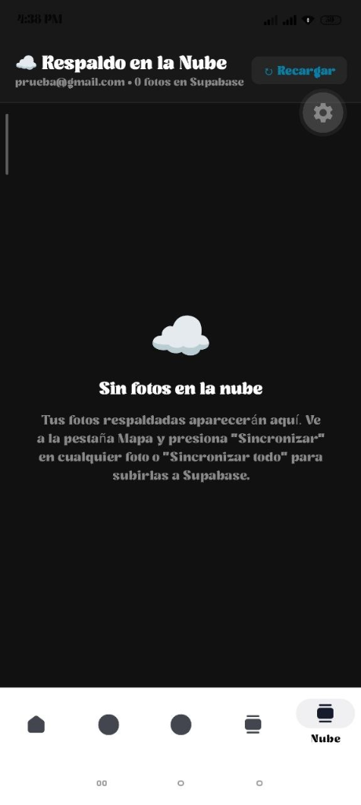<br/>
      <b>☁️ Pestaña Nube (Vacía)</b><br/>
      <sub>Vista remota con WebSockets (Realtime) activos, contador de fotos respaldadas y botón de recarga manual.</sub>
    </td>
    <td align="center" width="33%">
      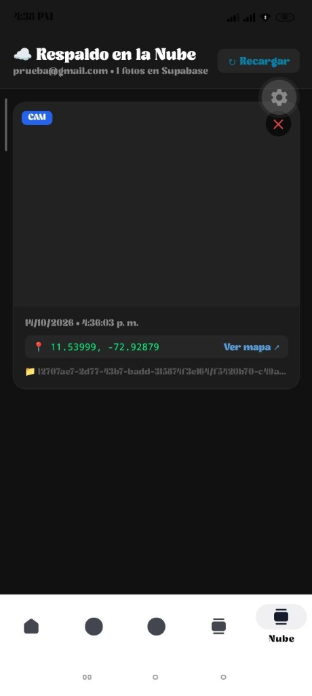<br/>
      <b>📁 Foto Respaldada en Storage Privado</b><br/>
      <sub>Visualización por URL firmada temporal. Se observa la ruta estructurada por carpeta de usuario: <code>&lt;user_id&gt;/&lt;client_id&gt;.jpg</code>.</sub>
    </td>
    <td align="center" width="33%">
      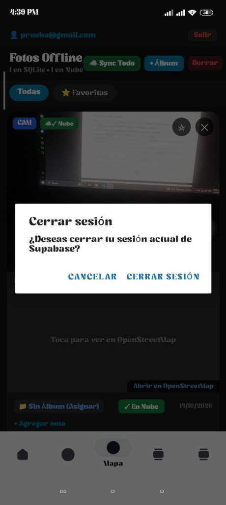<br/>
      <b>🚪 Cierre de Sesión Cifrado</b><br/>
      <sub>Diálogo de confirmación para cerrar sesión en Supabase y limpiar de forma atómica los fragmentos en <code>SecureStore</code>.</sub>
    </td>
  </tr>
</table>

### 🗄️ Semana 7: Base de Datos Local Offline-First (SQLite + Drizzle ORM)

#### 🔹 Galería Persistente, Favoritas y Relaciones
<table>
  <tr>
    <td align="center" width="25%">
      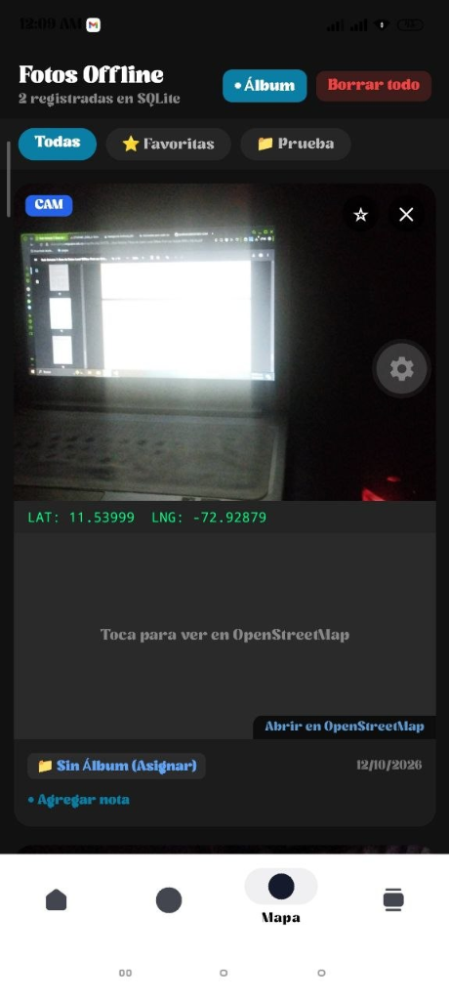<br/>
      <b>📸 Galería Offline en SQLite</b><br/>
      <sub>Persistencia en SQLite (<code>geocam.db</code>) y fotos en <code>FileSystem.documentDirectory</code>. Contador en vivo y barra GPS.</sub>
    </td>
    <td align="center" width="25%">
      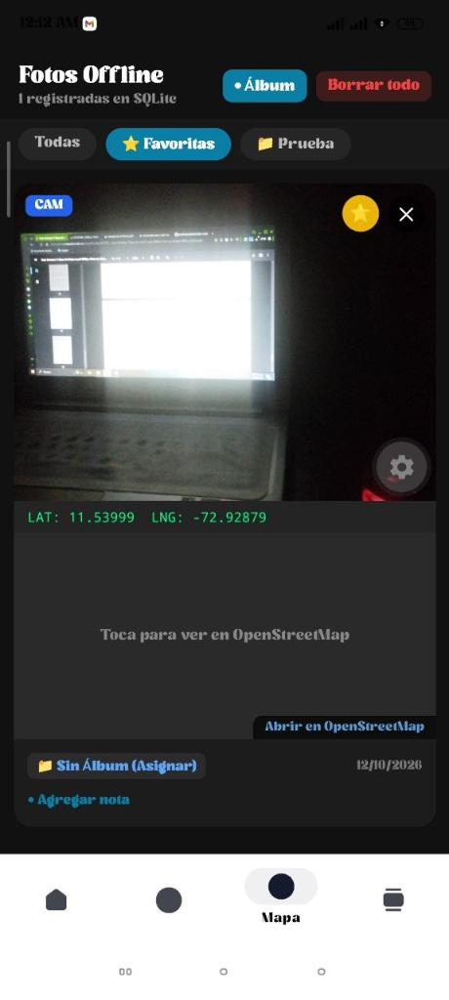<br/>
      <b>⭐ Favoritas (Migración 2)</b><br/>
      <sub>Columna <code>is_favorite</code> agregada por migración SQL. Alternado reactivo con estrella activa y filtrado instantáneo vía <code>useLiveQuery</code>.</sub>
    </td>
    <td align="center" width="25%">
      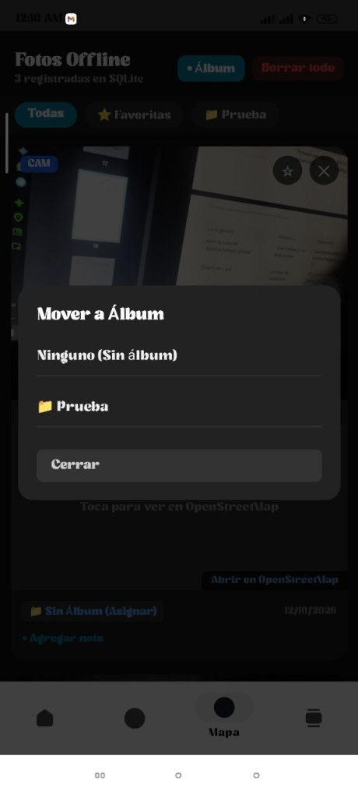<br/>
      <b>📁 Asignación a Álbum</b><br/>
      <sub>Modal para relacionar fotos con la tabla <code>albums</code> mediante clave foránea (<code>album_id</code>).</sub>
    </td>
    <td align="center" width="25%">
      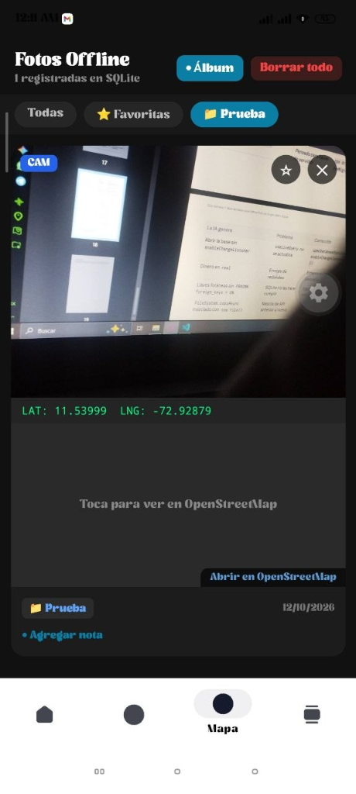<br/>
      <b>🔍 Filtrado por Álbum</b><br/>
      <sub>Pestaña del álbum <b>"Prueba"</b> activa, mostrando únicamente las fotos vinculadas a ese álbum y su badge correspondiente.</sub>
    </td>
  </tr>
</table>

#### 🔹 Gestión de Álbumes, Métricas e Integridad Referencial
<table>
  <tr>
    <td align="center" width="33%">
      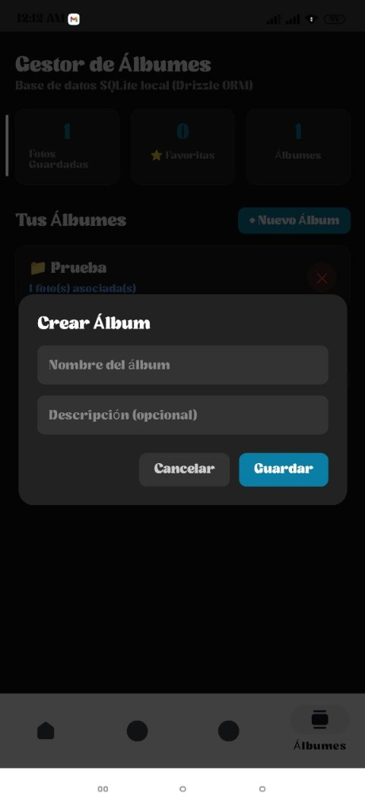<br/>
      <b>➕ Creación de Álbum</b><br/>
      <sub>Modal para ingresar nombre y descripción, insertando un nuevo registro en la tabla <code>albums</code>.</sub>
    </td>
    <td align="center" width="33%">
      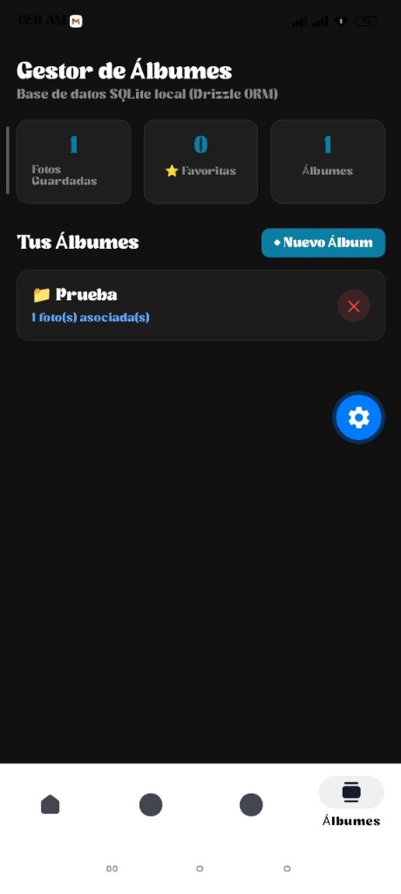<br/>
      <b>📊 Gestor y Métricas SQLite</b><br/>
      <sub>Pestaña <b>Álbumes</b> con métricas en tiempo real (Fotos, Favoritas, Álbumes) y conteo reactivo de fotos asociadas.</sub>
    </td>
    <td align="center" width="33%">
      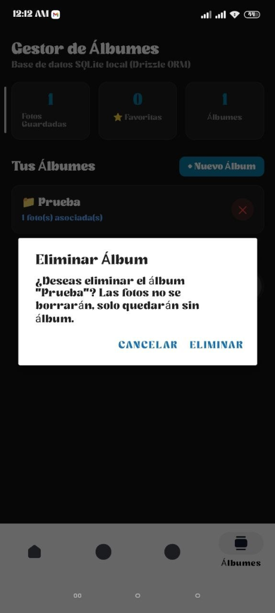<br/>
      <b>🗑️ Integridad (ON DELETE set null)</b><br/>
      <sub>Al eliminar el álbum, las fotos no se borran; quedan sin álbum preservando su integridad y archivo físico.</sub>
    </td>
  </tr>
</table>

### 🔐 Semana 6: Cámara, Permisos en Contexto y Degradación Elegante

<table>
  <tr>
    <td align="center" width="33%">
      <br/>
      <b>❌ Rechazado (Denied)</b><br/>
      <sub>La app pide el permiso en contexto con un botón "Conceder permiso".</sub>
    </td>
    <td align="center" width="33%">
      <br/>
      <b>🔒 Bloqueado (Blocked)</b><br/>
      <sub>Si el usuario denegó permanentemente, aparece el botón "Abrir Ajustes".</sub>
    </td>
    <td align="center" width="33%">
      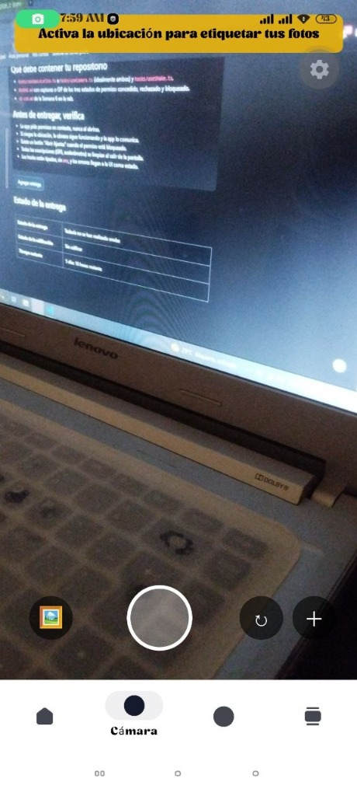<br/>
      <b>Cámara sin GPS</b><br/>
      <sub>Degradación elegante: la cámara sigue funcionando sin bloquear al usuario.</sub>
    </td>
  </tr>
</table>

---


## 🛠️ Tecnologías utilizadas

| Tecnología | Uso |
|---|---|
| **React Native 0.88** | Framework de desarrollo móvil |
| **Expo SDK 58** | Plataforma de desarrollo y build |
| **Expo Router** | Navegación basada en archivos |
| **expo-sqlite & kv-store** | Base de datos local SQLite (`openDatabaseSync`) y caché persistente |
| **drizzle-orm & drizzle-kit** | ORM type-safe con migraciones SQL (0000–0003) y consultas reactivas (`useLiveQuery`) |
| **@tanstack/react-query v5** | Motor reactivo de sincronización, `useInfiniteQuery` y persistencia offline |
| **expo-network** | Detección de conectividad conectada a `onlineManager` |
| **Supabase (Auth, DB, Storage, Realtime)** | Backend en la nube con RLS estricto y URLs firmadas |
| **expo-file-system** | Persistencia y descarga física de fotos en `documentDirectory` |
| **expo-camera / location / image-picker / sensors** | Hardware nativo con degradación elegante |
| **TypeScript** | Tipado estricto verificable con `tsc --noEmit` |

---

## 🏗️ Arquitectura Offline-First de 5 Capas

```
┌────────────────────────────────────────────────────────┐
│ 1. Pantalla (UI): geocam.tsx, mapa.tsx, explore.tsx    │
├────────────────────────────────────────────────────────┤
│ 2. Hooks Reactivos: useGeoPhotosDB, useAlbumsDB        │
├────────────────────────────────────────────────────────┤
│ 3. Repositorios: photoRepository, albumRepository      │
├────────────────────────────────────────────────────────┤
│ 4. Drizzle ORM / Esquema: schema.ts, relaciones        │
├────────────────────────────────────────────────────────┤
│ 5. Motor SQLite: expo-sqlite (openDatabaseSync)        │
└────────────────────────────────────────────────────────┘
```

---

## 📁 Estructura del proyecto

```
src/
├── app/
│   ├── _layout.tsx             # PersistQueryClientProvider + FocusManager + useDatabaseMigrations + Auth Guard
│   ├── index.tsx               # Redirect automático a /geocam
│   ├── login.tsx               # Inicio de sesión y registro con Supabase Auth (vía AuthContext)
│   ├── geocam.tsx              # Pantalla de cámara principal
│   ├── mapa.tsx                # Galería offline, barra de estado Sync, notas, favoritas y álbumes
│   ├── explore.tsx             # Gestor de Álbumes y métricas SQLite
│   └── nube.tsx                # Feed remoto con cursor, scroll infinito, búsqueda debounced y Realtime (vía hooks/contexto)
├── components/
│   ├── PermissionPrimer.tsx    # UI para solicitar permisos
│   ├── SyncMonitorModal.tsx    # Monitor de Estado (pendientes, cursor sync_meta, errores, force sync)
│   ├── app-tabs.tsx            # Navegación por pestañas (nativo)
│   └── app-tabs.web.tsx        # Navegación por pestañas (web)
├── context/
│   ├── AuthContext.tsx         # Sesión segura SecureStore + limpieza de caché al salir
│   └── GeoPhotosContext.tsx    # Puente reactivo + ejecución global de useSync()
├── db/
│   ├── client.ts               # Conexión SQLite con PRAGMA foreign_keys = ON;
│   └── schema.ts               # Tablas albums, photos (con deleted_at) y sync_meta
├── drizzle/
│   ├── 0000_init_albums_and_photos.sql
│   ├── 0001_add_notes_and_favorites.sql
│   ├── 0002_add_sync_fields.sql
│   ├── 0003_add_sync_meta_and_deleted_at.sql # Migración 4: sync_meta, deleted_at e índices
│   └── migrations.js           # Índice para el migrador móvil (m0000–m0003)
├── hooks/
│   ├── useAlbumsDB.ts          # Hook reactivo de álbumes
│   ├── useCamera.ts            # Hook de cámara y permisos
│   ├── useDatabaseMigrations.ts # Encapsula useMigrations(db, migrations) para mantener SQLite fuera de src/app/
│   ├── useDebouncedValue.ts    # Debounce para búsqueda remota
│   ├── useGeoLocation.ts       # Hook GPS en tiempo real
│   ├── useGeoPhotosDB.ts       # Mutaciones SQLite instantáneas + invalidación de ['sync']
│   ├── useNetworkOnline.ts     # Conectividad en vivo con expo-network
│   ├── usePhotosRealtime.ts    # Suscripción WebSocket encapsulada con limpieza e invalidación de queries
│   ├── usePostsFeed.ts         # useInfiniteQuery con paginación por cursor (created_at < último)
│   ├── useShake.ts             # Detección de sacudida
│   └── useSync.ts              # useQuery ['sync'] (refetchOnReconnect/Focus: 'always') + monitor SQLite
├── lib/
│   ├── queryClient.ts          # QueryClient v5 (gcTime, onlineManager, focusManager, persistencia)
│   ├── secureStorage.ts        # Adaptador chunked sobre expo-secure-store
│   └── supabase.ts             # Cliente Supabase v2
├── repositories/
│   ├── albumRepository.ts      # CRUD de álbumes
│   ├── photoRepository.ts      # Fuente de verdad SQLite con borrados lógicos y markSynced exacto
│   └── syncMetaRepository.ts   # Persistencia key/value de cursor, resultado y errores en sync_meta
├── services/
│   ├── cloudPhotos.ts          # Upload ArrayBuffer, Pull batch, cursor feed, soft delete y upsert
│   ├── photoStorage.ts         # Persistencia local y descarga binaria vía URL firmada
│   ├── syncConflicts.ts        # Función pura remoteWins(localUpdatedAt, remoteUpdatedAt)
│   └── syncService.ts          # Motor secuencial Pull -> Push con aislamiento de errores por fila
└── types/
    ├── declarations.d.ts       # Tipos para archivos .sql y migraciones
    └── geo.ts                  # Tipos compartidos GeoPhoto, Coords, SyncStatus
```

---

## 🧪 Hooks implementados

### `useCamera` (`hooks/useCamera.ts`)
Encapsula permisos de cámara, referencia a `CameraView` con `useRef`, captura de foto y toggle frontal/trasera con `prevState`.

### `useGeoLocation` (`hooks/useGeoLocation.ts`)
Maneja permisos de ubicación, watcher GPS en tiempo real con `watchPositionAsync`, y función de cleanup que remueve la suscripción al desmontar.

### `useShake` (`hooks/useShake.ts`)
Detecta el gesto de agitar usando el acelerómetro (`expo-sensors`). Usa `useRef` para el cooldown (sin re-renders) y `callbackRef` para evitar stale closures.

---

## ✅ Reglas de Hooks aplicadas

| Regla | Implementación |
|---|---|
| **Top-Level** | Todos los hooks se llaman al inicio de cada componente/hook |
| **Inmutabilidad** | `setPhotos((prev) => [photo, ...prev])` — spread operator |
| **prevState / Batching** | `setFacing((prev) => prev === 'back' ? 'front' : 'back')` |
| **Cleanup en useEffect** | `return () => { watcherRef.current?.remove(); }` |
| **useRef silencioso** | `intervalRef`, `callbackRef`, `lastShakeRef` sin re-renders |
| **Context API** | `GeoPhotosProvider` evita Prop Drilling entre pantallas |

---

---

## ☁️ Semana 8: Backend as a Service con Supabase

En la Semana 8 se expandió **GeoCam** conectándola con **Supabase** como plataforma de Backend as a Service (BaaS), implementando autenticación con correo/contraseña, almacenamiento cifrado por fragmentos en el dispositivo, base de datos remota PostgreSQL protegida por usuario mediante *Row Level Security (RLS)*, subida de fotos físicas a un bucket privado en *Supabase Storage* y suscripción en tiempo real con *Realtime*.

> **Principio de Diseño Offline-First:** SQLite con Drizzle ORM permanece como la **fuente de verdad local** en el dispositivo móvil, permitiendo un funcionamiento 100% autónomo sin conexión a internet. Supabase actúa como respaldo en la nube y punto de encuentro multi-dispositivo.

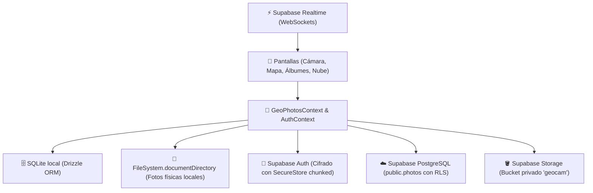

### 📋 Características implementadas (Taller T1-T6 + Casa C1-C7)

1. **Almacenamiento seguro por fragmentos (`lib/secureStorage.ts`):** Adaptador sobre `expo-secure-store` dividiendo tokens en bloques de 1000 bytes para superar la limitación nativa de 2048 bytes.
2. **Cliente Supabase seguro (`lib/supabase.ts`):** Configurado con `autoRefreshToken: true`, `detectSessionInUrl: false` y listener del ciclo de vida de la app (`AppState`) para suspender el refresco de tokens en segundo plano.
3. **Autenticación completa (`context/AuthContext.tsx`, `app/login.tsx`):** Registro e inicio de sesión con email/password, sesión persistente y cierre de sesión.
4. **Navegación protegida declarativa (`app/_layout.tsx`):** Si no hay sesión activa, la app muestra la pantalla de login directamente, sin redirecciones forzadas ni parpadeos.
5. **Migración incremental Drizzle (`0002_add_sync_fields.sql`):** Adición de `client_id` (UUID), `updated_at`, `remote_path`, `synced_at` y `owner_id` manteniendo intactas las migraciones previas.
6. **Subida binaria con `ArrayBuffer` (`services/cloudPhotos.ts`):** Prevención de archivos de 0 bytes garantizando subidas consistentes en React Native.
7. **Ruta estricta en Storage privado:** Fotos almacenadas bajo `${userId}/${clientId}.jpg` en el bucket privado `'geocam'`.
8. **Visualización con URLs firmadas:** Generación de URLs temporales con expiración (`createSignedUrl`) para visualizar imágenes de buckets privados de forma segura.
9. **Indicadores de estado de sincronización (`app/mapa.tsx`):**
   - ☁️✓ **Nube:** Foto sincronizada sin cambios pendientes.
   - ☁️⬆️ **Pendiente:** Foto modificada localmente pendiente de actualizar en la nube.
   - 📱 **Local:** Foto almacenada solo en el dispositivo.
10. **Sincronización masiva con progreso (`app/mapa.tsx`):** Botón `☁️ Sync Todo` con indicador en tiempo real ("Sincronizando X de Y...").
11. **Pestaña Nube con Realtime (`app/nube.tsx`):** Visualización de fotos respaldadas en Supabase con suscripción activa por WebSockets y limpieza garantizada del canal (`supabase.removeChannel`).
12. **Aislamiento multi-usuario:** Filtrado por `owner_id` para garantizar que en un mismo dispositivo cada usuario solo vea sus fotos locales.
13. **Eliminación sincronizada:** Al eliminar una foto, se limpian el archivo local, el registro SQLite y el objeto en Supabase Storage/PostgreSQL.

---

### ⚙️ Configuración en el Panel de Supabase (SQL Requerido)

Para desplegar la infraestructura en la nube, ejecuta el siguiente script en el **SQL Editor de Supabase**:

```sql
-- 1. Tabla remota de fotos
create table public.photos (
  id bigint generated always as identity primary key,
  user_id uuid not null default auth.uid() references auth.users (id) on delete cascade,
  client_id uuid not null unique,
  storage_path text not null unique,
  latitude double precision,
  longitude double precision,
  note text,
  favorite boolean not null default false,
  source text not null check (source in ('camera', 'gallery')),
  taken_at timestamptz not null,
  updated_at timestamptz not null,
  created_at timestamptz not null default now()
);

-- 2. Activar Row Level Security (RLS)
alter table public.photos enable row level security;

-- Políticas de la tabla photos (aislamiento estricto por usuario)
create policy "ver las mías" on public.photos
  for select to authenticated using ((select auth.uid()) = user_id);

create policy "crear las mías" on public.photos
  for insert to authenticated with check ((select auth.uid()) = user_id);

create policy "actualizar las mías" on public.photos
  for update to authenticated
  using ((select auth.uid()) = user_id)
  with check ((select auth.uid()) = user_id);

create policy "borrar las mías" on public.photos
  for delete to authenticated using ((select auth.uid()) = user_id);

-- 3. Habilitar Realtime en la tabla photos
alter publication supabase_realtime add table public.photos;

-- 4. Crear bucket privado 'geocam' y sus políticas RLS
insert into storage.buckets (id, name, public) values ('geocam', 'geocam', false);

create policy "subir a mi carpeta" on storage.objects
  for insert to authenticated
  with check (bucket_id = 'geocam' and (storage.foldername(name))[1] = (select auth.uid()::text));

create policy "leer mi carpeta" on storage.objects
  for select to authenticated
  using (bucket_id = 'geocam' and (storage.foldername(name))[1] = (select auth.uid()::text));

create policy "actualizar mi carpeta" on storage.objects
  for update to authenticated
  using (bucket_id = 'geocam' and (storage.foldername(name))[1] = (select auth.uid()::text));

create policy "borrar de mi carpeta" on storage.objects
  for delete to authenticated
  using (bucket_id = 'geocam' and (storage.foldername(name))[1] = (select auth.uid()::text));
```

### 🔐 Variables de Entorno

Crea un archivo `.env` en la raíz del proyecto (ignorado automáticamente por `.gitignore`):

```env
EXPO_PUBLIC_SUPABASE_URL=https://TU_PROYECTO.supabase.co
EXPO_PUBLIC_SUPABASE_PUBLISHABLE_KEY=tu_anon_publishable_key
```

> ⚠️ **Seguridad:** Nunca utilices `SUPABASE_SERVICE_ROLE_KEY` en el cliente móvil. Únicamente se debe emplear la clave pública `anon`.

---

## 🔄 Semana 9: Offline-First Bidireccional y TanStack Query v5

En la Semana 9 se evolucionó GeoCam hacia una arquitectura **Offline-First completa con sincronización bidireccional (Pull → Push)**, resolución determinista de conflictos (*Last-Write-Wins*), borrados lógicos sincronizados, paginación remota basada en cursor y persistencia offline de caché mediante **TanStack Query v5**.

### 🧭 Flujo de Sincronización Secuencial (`Pull → Push`)

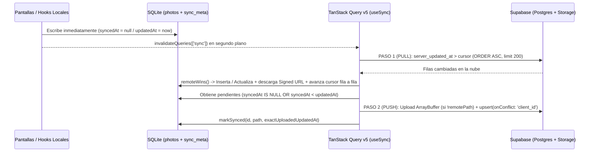

### ✨ Capacidades Clave Implementadas

1. **Reglas Offline-First y Consistencia de Datos:**
   - **SQLite es la fuente de verdad absoluta:** Lecturas y escrituras locales son instantáneas sin esperar a la nube.
   - **Condición pendiente estricta (`isPhotoPendingSync`):** `syncedAt === null || syncedAt < updatedAt`.
   - **Resolución de conflictos (`remoteWins`):** En caso de modificación simultánea multi-dispositivo gana el cambio más reciente (`remoteUpdatedAt > localUpdatedAt`).
   - **Marcado exacto de sincronización (`markSynced`):** Reemplaza `syncedAt` exactamente con el `updatedAt` subido (nunca `Date.now()`), preservando ediciones hechas durante la ventana de subida.
2. **TanStack Query v5 Estricto (`src/lib/queryClient.ts`, `src/hooks/`):**
   - Configurado exclusivamente con sintaxis de objeto, `gcTime`, y `status === 'pending'`.
   - Integración de `expo-network` con `onlineManager.setEventListener` y React Native `AppState` con `focusManager.setFocused`.
   - Hook automático `useSync` con `refetchOnReconnect: 'always'` y `refetchOnWindowFocus: 'always'`.
   - **Persistencia Offline del Muro Remoto:** `@tanstack/react-query-persist-client` sobre `expo-sqlite/kv-store`, limpiado automáticamente al cerrar sesión.
3. **Borrados Lógicos Sincronizados (Cero `SQL DELETE` directos):**
   - Eliminar una foto marca `deletedAt` y `updatedAt` localmente en SQLite (ocultándose inmediatamente con `isNull(photos.deletedAt)`).
   - Al sincronizar, se sube `deleted_at` mediante `upsert` y únicamente después de confirmarlo se destruyen los binarios en Storage y en `FileSystem.documentDirectory`.
4. **Muro Remoto Paginado por Cursor (`src/app/nube.tsx`, `src/hooks/usePostsFeed.ts`):**
   - `useInfiniteQuery` con `initialPageParam: null as string | null` y paginación `created_at < último` (evita duplicados frente a `.range()`).
   - Búsqueda en tiempo real debounced (`useDebouncedValue`) e scroll infinito verificando `hasNextPage && !isFetchingNextPage`.
5. **Monitor de Estado de Sincronización UI (`src/components/SyncMonitorModal.tsx`):**
   - Panel interactivo accesible desde las pestañas **Mapa** y **Nube** que consulta `sync_meta` y `photos` en tiempo real: muestra conectividad, cursor actual, conteo de subidas/borrados pendientes, historial de errores por elemento sin detener el resto del lote y botón de sincronización manual forzada.

### 🗄️ Migración Remota en Supabase (Semana 9)

Adicionalmente al esquema inicial de Semana 8, ejecuta el script idempotente incluido en [supabase/migrations_sync_v2.sql](supabase/migrations_sync_v2.sql) en el **SQL Editor de Supabase** para añadir `server_updated_at`, `deleted_at`, el trigger obligatorio y los índices compuestos:

```sql
alter table public.photos
  add column if not exists server_updated_at timestamptz not null default now(),
  add column if not exists deleted_at timestamptz;

create or replace function public.set_server_updated_at()
returns trigger language plpgsql as $$
begin
  new.server_updated_at = now();
  return new;
end;
$$;

drop trigger if exists trg_photos_server_updated_at on public.photos;
create trigger trg_photos_server_updated_at
  before insert or update on public.photos
  for each row execute function public.set_server_updated_at();

create index if not exists idx_photos_user_server_updated_at
  on public.photos (user_id, server_updated_at);
```

### 🧪 Matriz de Pruebas para C6

> **Nota:** Los resultados observados están respaldados por capturas reales en [`screenshots/`](screenshots/) y telemetría de `sync_meta`.

| # | Escenario | Resultado esperado | Implementación verificada en código | Resultado real observado (Dispositivo) |
|---|---|---|---|---|
| 1 | Foto tomada sin conexión; luego se reconecta | Se sube sola; pendientes vuelve a `0` | `addPhoto` guarda en SQLite (`syncedAt = null`) e invalida `['sync']`; `onlineManager` + `useSync` (`refetchOnReconnect: 'always'`) ejecutan `Pull → Push` al recuperar red y aplican `markSynced`. | ✅ **Aprobado** — Con modo avión (`11:13 p. m.`) quedan `2` pendientes en SQLite (`Al Día: 0`); al reconectar WiFi (`11:15:18 p. m.`) sube automáticamente `↑ 2 subidas • × 0 fallos` y vuelve a `0` pendientes ([Offline](screenshots/26-c6-1a-offline-pendientes-cola-sqlite.jpg) / [Reconexión](screenshots/27-c6-1b-reconexion-pendientes-a-cero.jpg)). |
| 2 | Foto creada en el teléfono A | Aparece en B con imagen y ubicación | Teléfono A sube binario a Storage y metadatos (`latitude`, `longitude`) vía Push; Teléfono B recibe evento Realtime (`usePhotosRealtime`) o Pull (`server_updated_at > cursor`), descarga vía Signed URL a `documentDirectory` y actualiza SQLite + feed. | ✅ **Aprobado** — Sincronizada con estado `✅ SQLite y Nube al día` (`1 en SQLite • 1 en Nube`, badge `☁️✓ Nube`) y coordenadas GPS `11.53986, -72.92631` en OpenStreetMap ([Evidencia](screenshots/28-c6-2-foto-sincronizada-ubicacion-gps.jpg)). |
| 3 | Nota editada en A y después en B, ambos sin conexión | En los dos queda la nota de B | `remoteWins(localUpdatedAt, remoteUpdatedAt)` en `syncConflicts.ts` compara timestamps ISO (Last-Write-Wins); al sincronizar B (último en editar) prevalece su nota en Supabase y el siguiente Pull en A actualiza SQLite local. | ⏳ Pendiente de adjuntar evidencia en dispositivo |
| 4 | Foto borrada en A | Desaparece en B y del bucket | Borrado en A marca `deletedAt` y `updatedAt`; Push hace upsert de `deleted_at` y elimina el objeto del bucket `geocam`; Pull en B aplica `softDeleteById` y elimina el archivo físico local (`FileSystem`). | ✅ **Aprobado** — Tras eliminar la foto, el monitor (`11:07:11 p. m.`) registra `↑ 1 subidas • × 0 fallos` (push del borrado lógico), quedando `0` pendientes, `0` borrados en cola y `0 Al Día` ([Evidencia](screenshots/29-c6-4-borrado-logico-sincronizado.jpg)). |
| 5 | Foto editada en A y borrada después en B, ambos sin conexión | Queda borrada en los dos (el borrado es el último cambio) | Tanto edición como borrado actualizan `updatedAt`; al ser mayor el timestamp de B, `remoteWins()` aplica en A el registro remoto con `deleted_at` y ejecuta el borrado lógico y limpieza local. | ⏳ Pendiente de adjuntar evidencia en dispositivo |
| 6 | Se corta la red a mitad de una sincronización de 5 fotos | Al reconectar termina sin duplicar filas ni archivos | Cada fila en `pushLocalPendingChanges` usa `client_id` (UUID único) con `upsert(..., { onConflict: 'client_id' })` y avanza `markSynced` individualmente dentro de su `try/catch`; el cursor de Pull avanza fila a fila en `sync_meta`. | ✅ **Aprobado** — Al cortar red (`11:09:56 p. m.`) quedan `↑ 2 subidas` (`Al Día: 2`) y `× 3 fallos` (`UnknownHostException`); al reconectar (`11:11:25 p. m.`) completa solo las `↑ 3 subidas` restantes (`× 0 fallos`), llegando a `5 Al Día` sin duplicados ([Corte](screenshots/30-c6-6a-corte-red-mitad-sync-5-fotos.jpg) / [Recuperación](screenshots/31-c6-6b-reconexion-sin-duplicados-5-fotos.jpg)). |
| 7 | Se cierra la app con fotos pendientes y se abre con red | Se sincroniza al abrir | Las filas pendientes persisten en SQLite (`syncedAt IS NULL \|\| syncedAt < updatedAt`); al iniciar la sesión autenticada, `GeoPhotosProvider` monta `useSync` y dispara automáticamente `runSyncCycle()`. | ⏳ Pendiente de adjuntar evidencia en dispositivo |

---

## 🚀 Instalación y ejecución

```bash
# Clonar el repositorio
git clone <URL_DEL_REPOSITORIO>

# Entrar a la carpeta del proyecto
cd GEOCAM

# Instalar dependencias
npm install

# Iniciar el servidor de desarrollo
npx expo start
```

> **Nota:** Esta app requiere un dispositivo físico para funcionalidades de cámara, GPS y acelerómetro. Escanea el código QR con **Expo Go** en tu teléfono.

---

## 👤 Autor

**Estudiante(s):** Leonardo Carrillo Caballero